<picture>
  <source media="(prefers-color-scheme: dark)" srcset="assets/hero-dark.svg"/>
  
</picture>

  

<picture>
  <source media="(prefers-color-scheme: dark)" srcset="assets/btn-github-dark.svg"/>
  
</picture> <a href="https://youtube.com/@ThisBratic"><picture>
  <source media="(prefers-color-scheme: dark)" srcset="assets/btn-youtube-dark.svg"/>
  
</picture></a> <a href="https://voidstrapp.pages.dev"><picture>
  <source media="(prefers-color-scheme: dark)" srcset="assets/btn-website-dark.svg"/>
  
</picture></a>

  

<!-- PROFILE:START -->
<picture>
  <source media="(prefers-color-scheme: dark)" srcset="assets/activity-dark.svg"/>
  
</picture>

  

<picture>
  <source media="(prefers-color-scheme: dark)" srcset="assets/streak-dark.svg"/>
  
</picture>

  

<picture>
  <source media="(prefers-color-scheme: dark)" srcset="assets/projects-dark.svg"/>
  
</picture>
<!-- PROFILE:END -->

  

<picture>
  <source media="(prefers-color-scheme: dark)" srcset="assets/wave-dark.svg"/>
  
</picture>

<a href="https://metawka.github.io/expressive-profile/"><picture>
  <source media="(prefers-color-scheme: dark)" srcset="assets/credit-dark.svg"/>
  
</picture></a>

